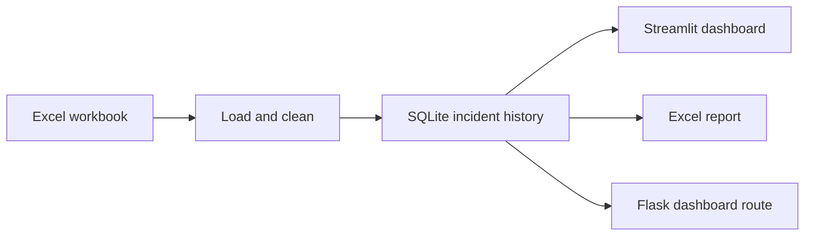

# LPG CP In-Transit Incident Analysis

<p align="center">
  <strong>Turn incident spreadsheets into clear, interactive operational insight.</strong><br />
  A lightweight dashboard for exploring in-transit LPG incident patterns, outcomes, and root causes.
</p>

<p align="center">
  <a href="https://www.python.org/"></a>
  <a href="https://streamlit.io/"></a>
  <a href="https://plotly.com/python/"></a>
  <a href="https://www.sqlite.org/"></a>
</p>

This project turns an Excel incident register into an interactive analysis workspace. Upload a workbook, let the application clean and enrich its rows, then explore incident counts, fatalities, injuries, timing, geography, FIR/DIR status, and reported root causes. A downloadable Excel report carries the analysis into a familiar, shareable format.

## What you can do

- **Explore incident patterns** by financial year, region, state, territory, month, weekday, date, and time of day.
- **Compare outcomes** using incident, fatality, and injury totals.
- **Review case progress** with FIR filing turnaround and DIR status summaries.
- **Inspect root causes** across the available root-cause fields.
- **Build a custom chart** by choosing a supported grouping, metric, financial year, and chart type.
- **Export an Excel report** containing summary tables and native Excel charts.
- **Accumulate multiple uploads** in SQLite; rows with a matching FIR number are replaced, so repeated or overlapping uploads do not create duplicate FIR records.

## How it works



1. **Load:** `data_loader.py` reads the source workbook’s two-row header layout.
2. **Prepare:** placeholder values are normalized; incident dates, times, and FIR submission times are parsed; derived dimensions and total fatality/injury counts are added.
3. **Store:** `database.py` upserts cleaned rows into a local SQLite database using `FIR NUMBER` as the record key.
4. **Analyze:** `charts.py` supplies the aggregation tables and interactive Plotly charts used by the dashboard.
5. **Export:** `excel_export.py` builds an `.xlsx` report with data tables and native openpyxl charts.

Financial years use the Indian April–March convention. Time values are grouped into four buckets, and missing or not-applicable source values are treated as blank for analysis.

## Dashboard views

| View | What it helps answer |
| --- | --- |
| Custom Chart | How does a chosen incident, fatality, or injury metric vary by a selected field? |
| Historic Trend | How do incident totals compare across financial years? |
| Region Wise | How do incidents and outcomes differ by region? |
| State Wise | Which states contribute the most incidents or outcomes? |
| Territory Wise | What does the breakdown look like within a selected region? |
| Monthly Breakup | How do incidents vary by month across financial years? |
| Week Days, Date Wise, Time Wise | When are incidents occurring? |
| Type of Consumer, Zone Wise | What do these fields show when the uploaded data includes them? |
| FIR / DIR Status | How quickly are FIRs filed, and what DIR statuses are recorded? |
| Root Cause | Which reported causes appear in the selected financial year? |

The project also exposes a Flask route for serving a dashboard summary in WSGI environments. The interactive upload and full analysis workflow is provided by the local Streamlit interface.

## Get started

### Requirements

- Python
- The packages listed in [`requirements.txt`](requirements.txt)
- An Excel workbook matching the source layout expected by the loader

### Run locally

Clone the repository and install its dependencies:

```bash
git clone https://github.com/OmSantoshBadade/In-Transit-Incident-Analysis-Model.git
cd In-Transit-Incident-Analysis-Model
python -m venv .venv
source .venv/bin/activate
python -m pip install -r requirements.txt
streamlit run app.py
```

On Windows PowerShell, activate the environment with:

```powershell
.venv\Scripts\Activate.ps1
```

Open the local address printed by Streamlit. Use **Data Management → Upload** in the sidebar to select an `.xlsx` workbook. The repository includes [`Demo_Retail_Intransit_Dataset_2015_2025.xlsx`](Demo_Retail_Intransit_Dataset_2015_2025.xlsx) as a demo input.

After data is loaded, choose a dashboard view or select **Download Excel report with charts and tables**.

## Input data and interpretation

The loader expects the workbook’s actual field names on its second row, with data beginning on the next row. It requires a `FIR NUMBER` column for upserts and uses fields such as incident date/time, region, state, territory, FIR/DIR status, and root-cause columns when present.

Some views depend on optional columns. If `CONSUMER TYPE` has no usable values, or the workbook does not include `ZONE`, those views show a no-data message instead of inventing results. Multi-year comparisons become informative as records from additional financial years are added.

This is an operational analysis aid. Results reflect the data supplied in the workbook and the project’s cleaning and grouping rules; review source records before using summaries for formal reporting or decisions.

## Data storage

By default, SQLite stores the database at the system temporary directory as `incident_data.db`. Set `INCIDENT_DB_PATH` to choose another location:

```bash
export INCIDENT_DB_PATH="$PWD/data/incident_data.db"
streamlit run app.py
```

Create the chosen parent directory if needed; the application creates it automatically. The sidebar’s **Delete all stored data** action permanently clears the local incident history after you confirm. Back up the database file if you need to preserve accumulated uploads.

For hosted deployments, confirm that the chosen storage location persists between application restarts and instances. The repository includes a Flask WSGI entrypoint (`app:app`); the Streamlit interface is started with `streamlit run app.py`.

## Project structure

| File | Responsibility |
| --- | --- |
| `app.py` | Streamlit dashboard and Flask WSGI entrypoint |
| `data_loader.py` | Excel parsing, cleaning, and derived analysis fields |
| `database.py` | SQLite storage, FIR-number upserts, and summary statistics |
| `charts.py` | Analysis tables and Plotly chart builders |
| `excel_export.py` | Downloadable Excel workbook and native charts |
| `tests/` | Tests for database behavior, export, and dashboard functionality |
| `Demo_Retail_Intransit_Dataset_2015_2025.xlsx` | Demo workbook |

## Run the tests

Install the project requirements, then run:

```bash
python -m pytest
```

## Built with

[Streamlit](https://streamlit.io/) · [Pandas](https://pandas.pydata.org/) · [Plotly](https://plotly.com/python/) · [SQLite](https://www.sqlite.org/) · [openpyxl](https://openpyxl.readthedocs.io/) · [Flask](https://flask.palletsprojects.com/)
